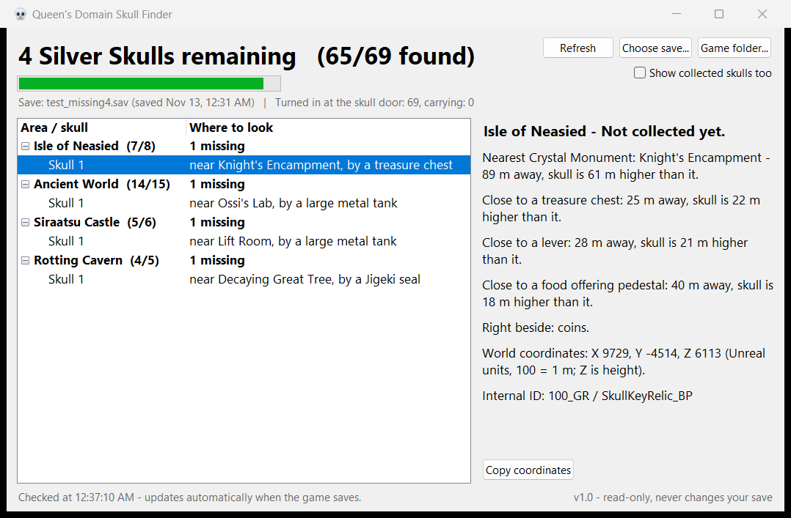

<p align="center"></p>

# Queen's Domain Skull Finder

A small Windows app that reads your **Queen's Domain** save and shows which of the
**69 Silver Skulls** you still need, and where to find each one.



## Download

Get **SkullFinder-vX.Y.zip** from the [Releases](../../releases) page, unzip it, and run `SkullFinder.exe`.
No install and no Python needed.

> Windows may show a SmartScreen warning because the app isn't code-signed.
> Click **More info → Run anyway**. Every release is built from this source code by
> [GitHub Actions](.github/workflows/release.yml), so you can check exactly what's inside.

## Features

- **Finds everything automatically.** It locates the game in any Steam library and picks your newest save.
- **Counts what's left.** For example "4 Silver Skulls remaining (65/69 found)", plus how many you've turned in at the skull door.
- **Tells you where to look.** Missing skulls are grouped by area. Each one lists the nearest Crystal Monument, nearby landmarks
  (Wind Gems, Wing Altars, statues, seals, secret walls, chests…), and whether the skull is higher or lower than them.
  Place names come straight from the game, so they match what you see on screen.
- **Updates live.** Keep it open while you play and it refreshes every time the game saves.
- **Read-only.** It never modifies your save or the game.

## How it works

Every Silver Skull in the game's levels has a unique ID. When you pick one up, the game writes that ID into
your save (`SavableActorStates`). Skull Finder:

1. reads the skull pickups and nearby landmarks from the game's own `.pak` file (Unreal Engine 4.27),
2. reads the place names from the game's string table,
3. lists every skull whose ID your save doesn't contain yet.

It ships **no game data**. Everything is read from your own install at runtime and cached in
`%LOCALAPPDATA%\QDSkullFinder` (safe to delete). Saves are read from
`%LOCALAPPDATA%\QueensDomain\Saved\SaveGames`.

## Run from source

Requires Python 3.10+ on Windows (tkinter is included with the python.org installer).

```bat
cd src
python SkullFinder.pyw
```

You can also pass a save file: `python SkullFinder.pyw path\to\World0.sav`.

## Build the .exe

```bat
pip install pyinstaller
cd src
python -m PyInstaller --onefile --windowed --name SkullFinder --icon skull.ico --add-data "skull.ico;." SkullFinder.pyw
```

The exe ends up in `src/dist/`. To publish a release, push a tag such as `v1.0`. The
[release workflow](.github/workflows/release.yml) builds the exe on GitHub and attaches the zip to the release.

## Files

| Path | What it is |
| --- | --- |
| `src/SkullFinder.pyw` | The window (tkinter) |
| `src/qdcore.py` | Reads the game files and the save, and writes the descriptions |
| `src/make_icon.py` | Draws the skull icon (`skull.ico`, `docs/icon.png`) |
| `src/README.txt` | The short readme that ships inside the release zip |

## Limitations

- Windows and Steam only. Another install location works through the **Game folder…** button.
- A game update could change the file format. If that happens the app shows an error instead of wrong results.
  Please open an issue.
- The game has no compass, so the app gives landmarks and heights rather than directions.

## License

[MIT](LICENSE). Fan-made; not affiliated with the developers of Queen's Domain.

## Donations Appreciated

https://www.paypal.com/ncp/payment/HHSQWA3336CQW
